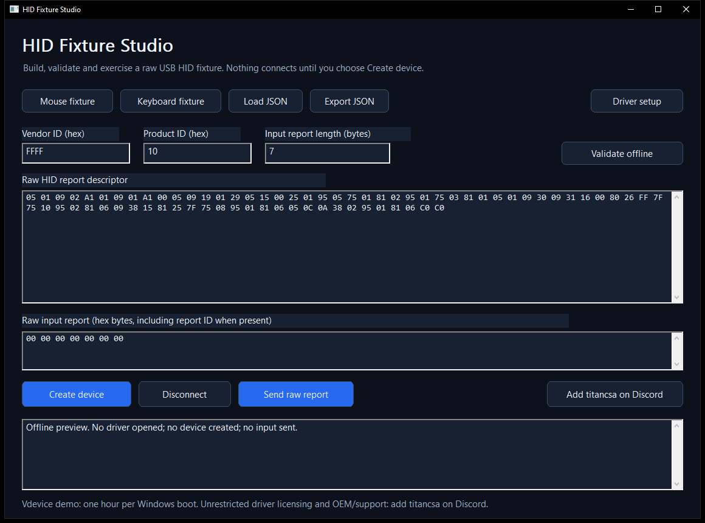

# HID Fixture Studio

Create and exercise a **virtual USB HID test device** from an editable report descriptor. A compact Windows C++ application for QA, accessibility research and HID integration work, powered by [Vdevice](https://github.com/TitanCSA/Vdevice).



**[Download the complete Windows release](https://github.com/titanfyre/HID-Fixture-Studio/releases/latest)**  -  For unrestricted driver licensing, OEM integration or support, add **`titancsa`** as a friend on Discord.

## Install and use

1. Windows 10/11 **x64**: extract the complete release ZIP.
2. Run `Dependencies/VdeviceSetup.exe`, choose Install, and restart Windows if requested.
3. Open `HIDFixtureStudio.exe`. Choose a mouse/keyboard fixture, or edit the VID/PID, raw report descriptor and input length.
4. Choose **Validate offline**, then **Create device**. Live access requests administrator elevation when needed. Wait for Ready.
5. Enter exact hex report bytes and choose **Send raw report**. Use a neutral report to release held keys/buttons. **Disconnect** removes the fixture; closing the application also removes its owned device.

Sending affects Windows and the focused application. Start with neutral reports in a test VM; this application never starts capture or creates a device just because it was opened. Editing descriptors requires disconnecting and recreating the device.

Before an explicit Send, HID GET_REPORT returns an initial cache of zero data
with a declared report ID when applicable; editor report bytes are not used as
startup state. **Zero is not a universal semantic neutral value** for arbitrary
HID layouts. Validate the report meanings in a test VM before connecting a
custom fixture. A successful Send updates the cached state.

**Load JSON / Export JSON** use a portable fixture format shared with Input CI Runner. The editor exports the current report at `at_us: 0`. The included examples show scheduled sequences. HID input reports include their report ID when one is defined.

## Scope

- One full-speed USB HID interface with interrupt IN endpoint `0x81`, 1 ms descriptor interval, and fixed input reports of 1-64 bytes.
- Editable VID/PID, raw HID report descriptor and report bytes; application-side keyboard and mouse examples.
- Bounded structural/HID layout validation, readable errors and explicit device lifecycle.
- HID class controls are serviced by the application; unknown controls stall. This is a test fixture, not an exact emulator for every proprietary device. Long HID items and variable-size input layouts are rejected by this version.

`FFFF:0010` / `FFFF:0011` are development examples, not assigned production USB identities. Use identifiers you are authorized to use. An accepted report is not proof of delivery timing; operating-system scheduling and applications affect observations. No zero-jitter, universal compatibility or protected-game support claim is made.

## Demo and production

The bundled **Microsoft-signed Vdevice demo driver** allows one hour per Windows kernel boot, starting at first successful virtual-device creation. Windows Restart starts a new allowance. Driver signing covers the driver package, not this application EXE.

The application source is MIT licensed and has no application-layer paywall. An unrestricted production driver and integration/support are available separately: Discord **Add Friend -> `titancsa`**. Production builds can select a privately supplied SDK with `-SdkDirectory`; no private SDK, key, server source or kernel source is included here.

## Build and verify

The matching Vdevice demo driver source is available; see
[driver/README.md](driver/README.md) for build instructions and separate
evaluation-source terms. Those terms apply to Titan-authored driver code. Third-party
source licenses and existing application/SDK licenses remain applicable. Full/commercial
implementation and private signing or activation material are excluded.

Install Visual Studio 2022 C++ tools, Windows SDK and CMake, then run:

```powershell
.\Build.ps1 -Screenshot
```

`-AddressSanitizer` enables memory instrumentation with a supported Visual Studio toolset. The build runs strict parser/descriptor tests and `--self-test` offline. `--preview` and `--screenshot file.png` also open no driver and send no inputs. Real Windows enumeration and hardware/application compatibility require live VM/target-system testing.

`App/Fixture.h/.cpp` contain the bounded scenario parser and USB builder. `App/Session.cpp` owns all live Vdevice calls on one worker. `SDK/` contains the unchanged two-file demo SDK; Demo/evaluation driver source is documented in [driver/README.md](driver/README.md). Third-party JSON licensing is embedded in its header.

## Responsible use

Built for lawful testing, accessibility and software development. You are responsible for authorizations, laws and third-party rules. Illegal, malicious and unauthorized uses are not endorsed. Provided **AS IS**, without warranties; to the extent permitted by law, the author is not liable for misuse or damages. Mandatory rights remain unaffected. Driver binaries have separate distribution terms.

## Commercial integration and support

<!-- full-version-contact:start -->
> [!IMPORTANT]
> **Get the full driver version without demo restrictions**
>
> **Discord username: `titancsa`**
>
> Open Discord, choose **Friends > Add Friend**, enter **`titancsa`**, then send a direct message. Ask for the **full driver version without the demo time limit**, and mention **HID Fixture Studio**.
>
> The demo limit belongs to **Vdevice**, the driver used by this project. Ask for pricing and the appropriate license / activation instructions; the application or wrapper source keeps its existing license.
<!-- full-version-contact:end -->
